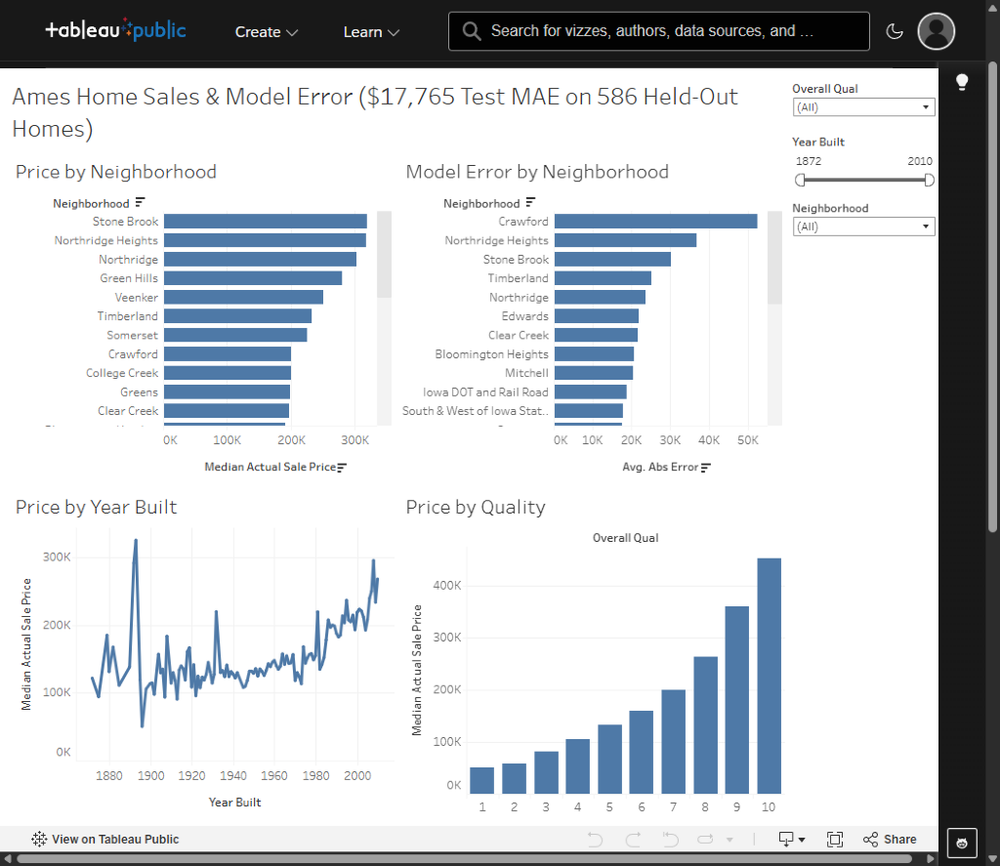

# Ames Home Sales & Model Error — Tableau Public Dashboard

Interactive BI workbook built on the real **2,930-row Ames, Iowa housing sales dataset** (`data/raw/AmesHousing.tsv`) paired with held-out predictions from the saved Random Forest pipeline (`artifacts/serving/model.skops`, **586 held-out homes**, **\$17,765 Test MAE** vs. **\$63,823** training-median baseline — **72.2% lower**, `R² = 0.886`).

- **Live Tableau Public Dashboard:** [Ames Home Sales & Model Error](https://public.tableau.com/app/profile/michael.martiradonna/viz/AmesHomeSalesandModelError/AmesHomeSalesModelError)
- **Data preparation script:** [scripts/export_tableau_data.py](../scripts/export_tableau_data.py)
- **Tableau source dataset:** [ames_tableau_dataset.csv](ames_tableau_dataset.csv) (`2,930` rows, `26` columns)
- **Neighborhood summary:** [ames_neighborhood_summary.csv](ames_neighborhood_summary.csv) (`28` neighborhoods)



## Dashboard Views & Interactive Filters

Global filters across the dashboard (`Apply to Worksheets -> All Using This Data Source`) let viewers slice all four views simultaneously by **Overall Quality (1–10)**, **Year Built** (`1872`–`2010`), and **Neighborhood**:

1. **Price by Neighborhood** — Horizontal bar chart comparing all 28 Ames neighborhoods sorted descending by median sale price (`MEDIAN(Actual_Sale_Price)`).
2. **Model Error by Neighborhood (586 Held-Out Homes)** — Horizontal bar chart filtered to `Split = Held-out Test`, sorted descending by Mean Absolute Error (`AVG(Abs_Error)`), showing where the Random Forest is tightest versus where high-variance homes drive larger dollar errors.
3. **Price by Year Built** — Historical trend line of median sale price across construction years (`1872`–`2010`).
4. **Price by Quality** — Bar chart of median sale price across discrete overall material and finish quality ratings (`1`–`10`).

## Key Findings From the Real Ames Data

- **Highest median sale prices:** Stone Brook (\$319,000, `n=51`), Northridge Heights (\$317,750, `n=166`), and Northridge (\$302,000, `n=71`).
- **Highest held-out dollar error (neighborhoods with ≥ 5 held-out homes):**
  - Crawford: **\$52,526 MAE** (`n=14`, vs. \$92,118 baseline) — older, heterogeneous homes with wide price spread.
  - Northridge Heights: **\$36,827 MAE** (`n=45`, vs. \$186,582 baseline — 80% error reduction) — luxury price tier drives larger absolute dollar swings.
  - Stone Brook: **\$30,270 MAE** (`n=15`, vs. \$158,348 baseline — 81% error reduction).
- **Lowest held-out dollar error (≥ 5 held-out homes):** Meadow Village (**\$5,984 MAE**, `n=9`), Briardale (**\$7,632 MAE**, `n=6`), Northpark Villa (**\$8,167 MAE**, `n=8`), Sawyer (**\$9,180 MAE**, `n=32`), and Gilbert (**\$9,869 MAE**, `n=27`) — uniform housing stock yields tight predictions.

## Regenerating the Tableau Dataset

From the repository root:

```powershell
.\.venv\Scripts\python.exe scripts\export_tableau_data.py
```

The script verifies the source dataset MD5 hash, reproduces the exact train/validation/test split (`1,758 / 586 / 586`), asserts parity with the documented **\$17,765** model MAE and **\$63,823** baseline MAE, and writes both CSVs into `bi/`.
